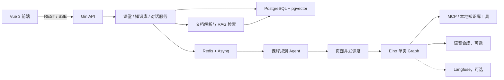

# Narra

<p align="center">
  
</p>

> 把一句学习需求，变成一堂有人讲、能互动、可回看的课。

Narra 是面向个人学习者的多智能体课堂平台。输入想学的主题，可附上自己的资料；系统先生成课程大纲，再逐页生成内容、讲解稿和语音。学习者可以边看边提问，也可以回看已经完成的页面。

## Narra 是什么

普通问答适合解决单个问题，但学习一个主题还需要内容顺序、讲解节奏和反馈。Narra 将学习目标转为课程计划，用页面级 Agent 生成讲解、测验或交互内容，并让教师、学生等角色 Agent 在课堂里参与讨论。

课程大纲落库后即可查看，页面按计划并发生成；已经完成的页面可以先进入课堂，失败页面可以单独重试。

## 核心能力

| 能力 | 说明 |
| --- | --- |
| 课程规划 | 根据学习目标和可选材料生成大纲、学习目标、页面顺序与先修关系，最多 15 页 |
| 页面生成 | Eino Graph 编排单页规划、调研、内容、讲稿、审核和修订；按审核意见从对应步骤继续 |
| 渐进式课堂 | 大纲先展示，页面按依赖与并发上限生成；已完成页面可先播放，进度通过 SSE 更新 |
| 多智能体讨论 | 教师、学生等角色在课堂中参与问答和讨论，保留对话上下文与共享记忆 |
| 个人知识库 | 上传资料后解析、切分、向量化；检索时结合向量与词法召回、可选重排及上下文装配 |
| 工具扩展 | 本地知识库工具与外部 MCP 工具统一提供给 Agent，远端工具可动态发现 |
| 异步与恢复 | Redis + Asynq 执行长任务；页面租约、checkpoint 与失败页重试支持中断恢复 |
| 链路观测 | 可选接入 Langfuse，查看 Agent、模型及工具调用的执行过程 |

## 系统架构



后端从 `internal/app/app.go` 装配 API、服务、仓储和 Worker。课程生成分为两段：规划 Agent 校验并保存大纲，页面调度器再按先修关系和并发上限执行每一页。Eino Graph 只管理**单页内部**的生成与审核；页与页之间的并发由调度器负责。页面内容、阶段和断点保存在 PostgreSQL，前端通过 SSE 获取状态变化。

## 技术栈

| 层次 | 技术 |
| --- | --- |
| 后端 | Go 1.25、Gin、GORM、Zap、JWT |
| Agent | CloudWeGo Eino（Graph / Chain / ReAct）、MCP Go SDK |
| 数据与任务 | PostgreSQL、pgvector、Redis、Asynq |
| 检索 | Markdown/代码切分、向量与词法召回、RRF 融合、可选 Rerank |
| 前端 | Vue 3、Vite 8、Tailwind CSS v4、Pinia、vue-i18n |
| 可选服务 | OpenAI 兼容大模型与 Embedding、阿里云百炼 TTS、Langfuse、阿里云 OSS |

## 快速开始

### 前置环境

- Go 1.25+、Node.js 20.19+ 或 22.12+、npm。
- PostgreSQL 与 [pgvector](https://github.com/pgvector/pgvector) 扩展、Redis。两者都需要可连接；生成队列依赖 Redis。
- 可用的 OpenAI 兼容大模型接口。知识库向量化、语音、MCP 搜索与文档解析按需配置。

### 1. 准备数据库

创建 `narra` 数据库，并确保 PostgreSQL 已安装 pgvector。服务启动时会执行 `CREATE EXTENSION IF NOT EXISTS vector` 和 GORM AutoMigrate，因此连接账号需要建扩展与建表权限。词法检索索引会优先使用 `pg_bigm`，没有时尝试 `pg_trgm`；两者都不可用时仍可检索，但大数据量下可能较慢。

已有数据库升级时先阅读 [迁移说明](migrations/README.md)，不要对存量库直接套用新库步骤。

### 2. 配置本地环境

PowerShell：

```powershell
Copy-Item configs/config.example.yaml configs/config.yaml
Copy-Item .env.example .env
```

Bash：

```bash
cp configs/config.example.yaml configs/config.yaml
cp .env.example .env
```

在 `.env` 中配置 `POSTGRES_*`、`REDIS_*` 和 `JWT_SECRET`；数据库名和端口也可在 `configs/config.yaml` 中调整。`JWT_SECRET` 同时用于已保存 API Key 的加解密，部署后不要随意更换。两个本地配置文件均被 Git 忽略，不要提交真实密钥。

示例配置默认关闭模型、短信、语音、文档解析和 Langfuse，便于先完成服务初始化。要从界面注册新账号，需要按实际短信服务配置 `sms`；已有账号可使用密码登录。要生成课堂，还需在设置页添加模型，或在 `configs/config.yaml` 启用 `default_llm` 并设置 `NARRA_DEFAULT_LLM_API_KEY`。向量化、TTS 与外部 MCP 工具分别按需启用；关闭 TTS 时页面仍可生成文字内容。

平台默认模型的配置示例（模型地址和 ID 换成实际值，密钥放在 `.env`）：

```yaml
default_llm:
  enabled: true
  name: "平台默认模型"
  base_url: "https://example.com/v1"
  model: "实际模型 ID"
  timeout: 60s
```

### 3. 启动后端与前端

在仓库根目录启动后端：

```bash
go run ./cmd/server -c configs/config.yaml
```

另开终端启动前端：

```bash
cd frontend
npm install
npm run dev
```

后端默认监听 `http://localhost:8080`，前端开发地址为 `http://localhost:5173`；Vite 将 `/api` 和 `/audio` 代理到后端。访问 `http://localhost:8080/api/v1/health` 可检查 API 是否启动。

### 4. 配置可选能力

| 能力 | 配置入口 | 说明 |
| --- | --- | --- |
| 平台默认模型 | `default_llm` + `NARRA_DEFAULT_LLM_API_KEY` | 填写 OpenAI 兼容地址和模型 ID；用户也可在设置页添加个人模型 |
| 个人知识库 | 设置页 Embedding 配置 | 需要向量服务；PDF、Office 与图片解析还需启用本地文档解析器 |
| 语音讲解 | `tts` + `TTS_API_KEY` | 启用后使用百炼 TTS 合成讲解音频 |
| 外部工具 | 登录后的 MCP 服务配置 | 可接入兼容的 MCP Server；本地 `rag_retrieve` 工具独立注册 |
| 链路观测 | `langfuse` + `LANGFUSE_PUBLIC_KEY` / `LANGFUSE_SECRET_KEY` | 启用后上报课堂生成与讨论链路 |
| 对象存储 | `storage.oss` + `OSS_ACCESS_KEY_ID` / `OSS_ACCESS_KEY_SECRET` | 四项 OSS 配置填齐时使用 OSS；全空时使用本地目录 |

## 项目结构

```text
cmd/server/           后端入口
configs/              YAML 配置样例；本地 config.yaml 不提交
internal/
  agent/classroom/    课程规划、页面 Graph 与执行器
  agent/discussion/   多智能体课堂讨论
  api/                Gin 路由与接口
  app/                依赖装配和启动流程
  bootstrap/          任务消费与恢复对账
  mcp/                MCP 连接、注册表和本地工具
  rag/                文档收录、切分和检索
  repository/         PostgreSQL 数据访问
  service/            业务服务
  worker/             Asynq 任务定义与队列
pkg/                  配置、数据库、模型及公共组件
frontend/             Vue 3 应用
migrations/           存量库迁移与种子数据说明
docs/                 模块设计与实现文档
```

## 常用命令

```bash
go test ./...                 # 后端测试
go vet ./...                  # Go 静态检查
cd frontend && npm run test  # 前端测试
cd frontend && npm run build # 前端类型检查与构建
```

仓库也提供 `make run`、`make test`、`make build` 等命令；Windows PowerShell 可直接使用对应的 `go` / `npm` 命令。

## 文档索引

- [课堂规划与页面执行](internal/agent/classroom/generate.go)
- [页面 Graph](internal/agent/classroom/page_graph.go)
- [异步任务装配与恢复](internal/bootstrap/worker.go)
- [MCP 工具接入](docs/modules/agent-mcp-tools.md)
- [数据库设计](docs/database-design-v1.md)
- [数据库迁移说明](migrations/README.md)

README 介绍项目入口和运行方式。专项设计细节以对应文档及当前代码为准。

## License

仓库根目录目前没有统一的 `LICENSE` 文件；使用或再发布代码前请与项目维护者确认授权范围。
