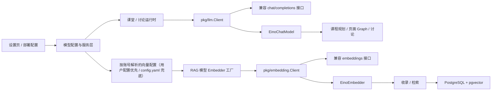

# 设计文档：LLM 与 Embedding 模型层

本文档说明 Narra 当前的对话模型与向量模型设计，重点是模块边界、运行时选型、Eino 适配和配置变化后的行为。模型的实际填写步骤见 [模型接入指南](model_integration_guide.md)；全站业务流程见 [README](../README.md)。

## 1. 目标与边界

Narra 需要两类不同的模型能力：

| 能力 | 使用场景 | 当前协议 | 实现入口 |
| --- | --- | --- | --- |
| 对话模型（LLM） | 课程规划、页面 Graph、课堂讨论与工具调用 | OpenAI 兼容 `/chat/completions` | [`pkg/llm/`](../pkg/llm/) |
| 向量模型（Embedding） | 文档切片入库、问题向量化与知识检索 | OpenAI 兼容 `/embeddings` | [`pkg/embedding/`](../pkg/embedding/) |

“OpenAI 兼容”指接口协议，并不限定具体模型厂商。当前没有多协议 Provider 工厂，也没有把 LLM 和 Embedding 混成同一个客户端：两类请求、响应、超时和使用方不同。Rerank 与视觉模型有各自的设置和客户端，不属于本文的两条主链路。

## 2. 整体结构



`pkg/llm` 和 `pkg/embedding` 负责协议通信及响应校验；业务配置、用户归属、密钥解密和模型选择在上层服务与运行时处理。Eino 适配器负责转换框架类型，不重新实现 HTTP 请求。这样一处协议实现可供普通调用和 Agent 调用复用。

## 3. 对话模型链路

### 3.1 选择配置

用户在设置页新增一条 `llm_providers` 配置，填入 Base URL、模型 ID 列表、API Key 和超时。保存后默认未启用；连接测试逐个验证模型，全部通过后才允许启用。更新地址、模型、超时或密钥会使测试状态失效并停用配置。API Key 以密文落库，接口只返回是否已配置。

部署者还可在 `default_llm` 中配置平台模型。它不对应用户表中的一条 Provider 记录，使用专用 `provider_id` 标识。用户可选模型列表由当前用户已启用且测试通过的模型，与已启用的平台默认模型组成。创建课堂时，服务层校验提交的 `provider_id + model_id` 是否在这个列表里，并将选择保存在课程配置快照中。

### 3.2 构造运行时

课堂生成从课程保存的模型选择出发，在 [`internal/agent/classroom/runtime.go`](../internal/agent/classroom/runtime.go) 读取平台配置或用户 Provider、校验课程所有者、解密密钥，再构造 `llm.Client` 和 `EinoChatModel`。讨论使用 [`internal/agent/discussion/runtime.go`](../internal/agent/discussion/runtime.go) 构造自己的模型能力；同一讨论运行时中的模型、摘要器和提取器共用客户端。客户端在构造时固定 Base URL、密钥、模型 ID 与超时，是本次运行的配置快照。

[`pkg/llm/client.go`](../pkg/llm/client.go) 发送普通和流式对话请求，处理消息、工具声明、工具调用、推理内容与用量字段。普通调用在上下文中施加超时；流式调用跟随调用方的上下文取消，不用 HTTP 客户端的整条请求超时直接截断长回复。接口响应缺少 `choices` 等必要结构时返回明确错误。

[`pkg/llm/eino.go`](../pkg/llm/eino.go) 实现 Eino 的 `ToolCallingChatModel`：把 Eino 消息和工具定义转为协议请求，再把完成结果与流式增量转回 Eino 类型。工具调用参数可能分片到达，适配器保留其顺序标识供下游合并；消费者提前退出时会取消上游请求。`WithTools` 返回新实例，避免不同 Agent 共享实例时互相覆盖工具集。

## 4. Embedding 链路

### 4.1 连接配置与模型身份

Embedding 的连接配置分两层：用户自己保存的那份存在 `embedding_settings`（按账号、同一时间一条生效，密钥加密落库）；用户没配过时回退 `config.yaml` 的 `embedding` 段（平台默认，只读、不落库）。`embedding_models` 按账号记录稳定的模型名称、维度和默认标记。向量行通过 `model_id` 指回产生它的模型。连接配置发生变化，不会把旧向量重新归属给新模型。

在文档收录或检索的使用点，[`internal/rag/embedder.go`](../internal/rag/embedder.go) 用该账号解析出的连接配置（用户配置优先、缺失回退平台默认），结合模型行的名称与维度现建 `embedding.Client` 和 Eino 适配器。客户端不是启动时创建后长期持有，因为它在构造时已经固定地址与模型；每次使用前现取现建，设置变化自然被下一次调用看到。

**配置作用域**：解析在每次使用时按账号进行 —— 检索用请求账号（`ownership.FromContext`），收录用文档的 `OwnerID`（后台 worker 没有登录态，必须显式取）。设置页保存后立即对该账号生效，不需要热更新任何共享状态。用户配置存在但不可用（密钥失效、服务故障）时不会静默回退平台默认：向量路按失败降级为纯词法并告警。相关代码见 [`internal/service/embedding_setting_service.go`](../internal/service/embedding_setting_service.go)。

### 4.2 请求与校验

[`pkg/embedding/client.go`](../pkg/embedding/client.go) 将一批文本发送到 `/embeddings`，校验返回条数、顺序和向量维度，避免文本与向量错位写库。非 2xx 响应使用带状态码的 `HTTPError`；429 和 5xx 可由收录链路识别为适合稍后重试的错误。

[`pkg/embedding/eino.go`](../pkg/embedding/eino.go) 实现 Eino `Embedder`。RAG 通过同一工厂为收录和检索构造向量器；收录侧分批请求并按策略重试。检索时以数据库中的默认模型为准，只比较同一模型下的向量；另有词法召回，两路结果用 RRF 融合。向量模型变更后，存量文档需重新向量化，否则新模型下可能没有可召回的向量。

### 4.3 重排与视觉模型

Rerank 与 VLM 采用与 Embedding 相同的"两层配置"：用户自己的配置落库（`rerank_settings` / `vlm_settings`，按账号各至多一条生效），平台默认放在 `config.yaml` 的 `rerank` / `vlm` 段（只读，密钥由环境变量注入）。使用时按账号解析：用户启用项优先，缺失回退平台默认，两者都没有则该能力关闭（精排原样透传、视觉理解退化为纯 OCR）。

解析时机与 owner 来源：[`internal/rag/rerank.go`](../internal/rag/rerank.go) 的装饰器在每次检索时按请求账号（`ownership.FromContext`）现取配置并现建客户端；[`internal/rag/ingest.go`](../internal/rag/ingest.go) 在每次解析前按文档归属账号（`document.OwnerID`）取视觉配置。两者都不持有常驻运行时，设置页保存/启停之后下一次调用即生效。精排或视觉配置损坏（密钥解不开等）时按失败降级并告警，不静默回退平台默认。

## 5. 设计约束与扩展

| 约束 | 原因 |
| --- | --- |
| Base URL 填兼容 API 的根地址，不包含具体端点 | 客户端分别拼接 `/chat/completions` 与 `/embeddings` |
| 模型选择先经过服务层可用列表校验 | 不让未测试、未启用或非当前用户的配置直接进入课堂生成 |
| 向量写入保留 `model_id` 和维度 | 防止不同模型的向量混用，支持切换后的重新向量化 |
| Eino 适配留在协议客户端之外 | 框架类型转换与 HTTP 协议解析可以分别维护和测试 |
| 密钥不进入日志、文档或公开响应 | 用户密钥需加密保存，平台密钥从环境变量注入 |

增加一个兼容服务商通常只需配置其兼容地址和真实模型 ID。接入不兼容协议时，需新增协议实现与对应测试，并核对流式增量、工具调用及 Embedding 返回顺序；仅增加一个 Provider 名称不足以支持新协议。

## 6. 验证入口

模型层的离线测试主要位于 `pkg/llm/*_test.go`、`pkg/embedding/*_test.go`、`internal/rag/*_test.go`，可运行：

```bash
go test ./pkg/llm ./pkg/embedding ./internal/rag/...
```

真实接入仍需在设置页测试具体地址、密钥与模型 ID。详细配置和常见错误见 [模型接入指南](model_integration_guide.md)，持久化字段见 [数据库设计](数据库设计.md)。
